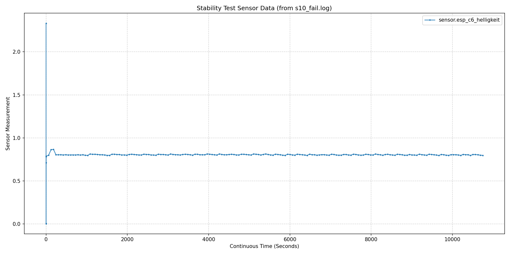

## Detailed Results per Scenario

The following is a detailed, scenario-by-scenario breakdown of the metamorphic testing results (S1–S10), focusing on the numerical outcomes, physical behavior, and specific failure reasons.

Picture of the test setup: [home_lab.pdf](home_lab.pdf)

---

### Control Adaptation

* **S1 (Monotonicity)**
  * **Goal:** Verify monotonic actuator-sensor response and uncover actuator scaling, sign inversions, or mapping faults.
  * **2% Tolerance:**
    * **Log:** [s1_2%.log](reports_final/s1_2%25.log)
    * **Result:** **10 PASSED**, 0 FAILED (5 runs of `TC_S1_Monotony_100` [0% &rarr; 100%], 5 runs of `TC_S1_Monotony_80` [20% &rarr; 80%]).
    * **Detail:** Monotonicity held across all test executions. Actuation commands produced expected directional increases at the sensor with no device-mapping faults detected.
  * **5% Tolerance:**
    * **Log:** [s1_5%.log](reports_final/s1_5%25.log)
    * **Result:** **5 PASSED**, 5 FAILED.
    * **Detail:** All 5 runs of `TC_S1_Monotony_100` passed, whereas all 5 runs of `TC_S1_Monotony_80` failed. In the framework, the `tolerance` parameter in the monotonicity relation defines a minimum required increase threshold ($followup > source + tolerance \cdot \max(|source|, |followup|, 1.0)$) to prevent ambient sensor noise from being misclassified as a monotonic increase. In one example test, shifting brightness from 20% to 80% increased measured illuminance from $2.582$ to $2.703$ ($\Delta = 0.121$ gain). it fell just short of the strict 5% noise margin requirement ($> 2.717$). This failed test shows that knowledge about the used hardware is mandatory.
  * **Fault Injection (Stuck / Disconnected Sensor):**
    * **Log:** [s1_2%_fault.log](reports_final/s1_2%25_fault.log)
    * **Result:** **0 PASSED**, 10 FAILED.
    * **Test Setup for the fail:** Whole Sensorbox (Arduino + sensor setup) was disconnected, so that the framework only see the last measured value that doesn't change anymore. 
    * **Detail:** When simulating an unresponsive sensor (stuck value, $followup = source$), the reading failed to exceed the baseline by the required margin. All 10 tests failed as expected, demonstrating that frozen sensor states are reliably detected.

* **S2 (Invariance)**
  * **Goal:** Verify system invariance and detect stale state, duplicate processing, or non-deterministic control behavior.
  * **Baseline Test without Fault Injection:**
    * **Log:** [s2.log](reports_final/s2.log)
    * **Result:** **5 PASSED**, 0 FAILED.
    * **Detail:** The digital twin responded deterministically through the cycle $75\% \rightarrow 0\% \rightarrow 75\%$. The final reading ($2.657$) closely matched the initial baseline ($2.652$, difference $0.005 \le 0.133$ which is under the 5% tolerance). This test shows that the DT acts deterministically for the same repeated inputs.
  * **With Fault Injection (Stuck Sensor):**
    * **Log:** [s2_fault.log](reports_final/s2_fault.log)
    * **Result:** **0 PASSED**, 5 FAILED.
    * **Test Setup for the fail:** Whole Sensorbox (Arduino + sensor setup) was disconnected, so that the framework only see the last measured value that doesn't change anymore.
    * **Detail:** All 5 test cases failed. The invariance relation explicitly requires that the intermediate state deviates significantly from the source state. Because the frozen sensor remained static at $2.56$ during the intermediate off-command, the test framework recognized that no physical actuation cycle took place, preventing false-positive passes from unresponsive devices.

* **S3 (Conservation)**
  * **Goal:** Verify conservation of aggregate illuminance across complementary luminaire configurations.
  * **Baseline Test without Fault Injection:**
    * **Log:** [s3_passed_vintage_lampe_nahe.log](reports_final/s3_passed_vintage_lampe_nahe.log)
    * **Result:** **20 PASSED**, 0 FAILED.
    * **Detail:** Measured illuminance remained within the 5% tolerance across all four complementary brightness configurations ($100/0$, $90/10$, $75/25$, $65/35$) over 5 repetitions each.
  * **With Fault Injection (Displaced Luminaire):**
    * **Log:** [s3_fault.log](reports_final/s3_fault.log)
    * **Result:** **15 PASSED**, **5 FAILED**.
    * **Detail:** Physically displacing `light.vintage_lampe` further away from the sensor caused all 5 runs of `TC_S3_Conservation_100` ($100/0 \leftrightarrow 0/100$) to fail ($2.211$ vs. $2.581$, difference = $0.370$, which exceeds the allowed 5% margin of $0.129$). In this extreme configuration, 100% of the light output is shifted to the displaced luminaire, maximizing the illuminance drop at the sensor. Conversely, the blended configurations ($90/10$, $75/25$, $65/35$) stayed marginally within tolerance ($\Delta \approx 0.111 \le 0.129$) because the superposition of both light sources mitigated the spatial displacement, keeping the measured variance just below the 5% threshold.

---

### Model / Device Evolution

* **S4 (Integrate Additional Luminaire)**
  * **Goal:** Validate registration, addressability, local response, and spatial impact when introducing an additional luminaire.
  * **Registration, Addressability, and Local Response Only:**
    * **Log:** [s4_without_conservation.log](reports_final/s4_without_conservation.log)
    * **Result:** **10 PASSED**, 0 FAILED (5 Monotonicity, 5 Invariance).
    * **Detail:** Confirms that the newly integrated luminaire (`light.nanoleaf_lampe`) is addressable, responds deterministically to actuation commands, and operates monotonically.
  * **With Conservation:**
    * **Log:** [s4_with_conservation.log](reports_final/s4_with_conservation.log)
    * **Result:** 10 PASSED, **20 FAILED**.
    * **Detail:** The 10 local response tests passed, but all 20 conservation tests with `light.vintage_lampe` failed intentionally. Because `light.nanoleaf_lampe` is an additional light source positioned in a different physical location rather than an identical optical replacement for `light.schreibtisch_lampe`, total light conservation does not hold.

* **S5 (Cross-Workplace Interference / Additional Sensor)**
  * **Goal:** Validate correct spatial binding, cross-workplace isolation, and multi-sensor proportionality.
  * **Result (Cross-Workplace without Wall):** 0 PASSED, **10 FAILED**.
    * **Log:** [s5_cross-workplace_without_wall.log](reports_final/s5_cross-workplace_without_wall.log)
    * **Detail:** An inverted proportionality relation (`not proportionality`, tolerance 50%) was defined to assert that actuating a luminaire at one workplace does not affect an adjacent workspace. All 10 tests failed because sensor responses were correlated (percentage changes deviated by only $36.60\% (max) \le 50\%$), correctly revealing significant optical light leakage between workplaces.
  * **Result (Cross-Workplace with Wall):** **10 PASSED**, 0 FAILED.
    * **Log:** [s5_cross-workplace_with_wall.log](reports_final/s5_cross-workplace_with_wall.log)
    * **Detail:** With a physical partition wall blocking direct optical spillover, percentage changes between the two sensors deviated by $79.58\% (min)  > 50\%$. The base proportionality relation failed as expected, allowing the inverted relation (`not proportionality`) to pass and confirming spatial isolation.
  * **Result (Proportionality Bounds Across Multiple Sensors):** 10 PASSED, **5 FAILED**.
    * **Log:** [s5_prop_failed.log](reports_final/s5_prop_failed.log)
    * **Detail:** All 10 tests for `TC_S5_Proportionality_80` (action $20 \rightarrow 80$) and `TC_S5_Proportionality_60` (action $40 \rightarrow 60$) passed with negligible deviations (well within 5% tolerance). However, all 5 runs of `TC_S5_Proportionality_100` ($0 \rightarrow 100$) failed, with observed percentage deviations of $90.96\%$ (Sensor 1: $+281.16\%$, Sensor 2: $+372.12\%$).
    * **Failure Explanation:**
      1. *Small-Baseline Sensitivity (Division by near-zero):* Proportionality is computed via relative percentage change: $\Delta\% = \frac{|followup - source|}{source}$. In `TC_S5_Proportionality_100`, the baseline input is 0% (lights off), where sensors measure only dark ambient noise ($s_1 = 0.69$ vs. $s_2 = 0.538$\). Switching to 100% produces almost identical absolute illuminance increases ($\Delta_1 = 1.94$ vs. $\Delta_2 = 2.002$, an absolute discrepancy of only $\approx 3\%$). However, dividing by the tiny baseline values severely magnifies minor ambient differences into drastically divergent percentages ($\frac{1.94}{0.69} = 281.16\%$ vs. $\frac{2.002}{0.538} = 372.12\%$).
      2. *Comparison with Higher Operating Baselines:* In contrast, the 80% and 60% test cases started with baseline inputs of 20% and 40%, producing baseline readings of $\approx 2.25$ and $2.16$. At these illuminated operating points, the denominator is robust against noise, yielding deviations of only $1.10\%$ and $0.09\%$.
      3. *Formula Suitability and Diagnostic Value:* While using relative percentage change ($\frac{|followup - source|}{source}$) is numerically sensitive when baseline values approach zero—drastically amplifying minor ambient differences, this failure is not purely a false positive. Instead, it provides valuable diagnostic insight: it exposes that the two sensors, despite scaling and responding almost identically under normal illumination, exhibit differing zero-point calibration offsets in near-darkness ($0.69$ vs. $0.538$). 

* **S6 (Replace Existing Sensor)**
  * **Goal:** Verify that replacing a physical sensor preserves system semantics and maintains consistent metamorphic relations.
  * **Log:** [s6.log](reports_final/s6.log)
  * **Result:** **30 PASSED**, 0 FAILED.
  * **Detail:** `sensor.esp_c6_helligkeit` replaced the previous sensor and successfully passed all 30 test cases (5 Monotonicity, 5 Invariance, and 20 Conservation tests across 4 brightness ratios summing to 100% (100/0, 90/10, 75/25, 65/35)), proving seamless semantic continuity. Sensor esp_c6_helligkeit got replaced and passed all 30 Tests, similar to the S1, S2 and S3 tests.

---

### Timing and Context

* **S7 (Observe Pipeline Latency)**
  * **Goal:** Measure latency between issuing an actuation command and detecting the corresponding physical settling at the sensor.
  * **Log:** [s7.log](reports_final/s7.log)
  * **Result Settling Time (Worst-case / Maximum across 5 calibration runs):**
    * [SUCCESS] `sensor.esp_c6_helligkeit` (state): **2.192s**
    * [SUCCESS] `sensor.esp_c3_helligkeit` (state): **3.030s**
    * [SUCCESS] `sensor.arbeitsplatz_helligkeit` (state): **2.004s**
  * **Result Initial Change Detection (Worst-case / Maximum across 5 calibration runs):**
    * [SUCCESS] `sensor.esp_c6_helligkeit` (state): **1.327s**
    * [SUCCESS] `sensor.esp_c3_helligkeit` (state): **2.379s**
    * [SUCCESS] `sensor.arbeitsplatz_helligkeit` (state): **1.008s**
  * **Result Stability:** **1 PASSED**, 0 FAILED.
  * **Detail:** The latency calibration establishes the physical settling time of the hardware pipeline (transmission delay + sensor stabilization). 

* **S8 (Different Daylight Conditions)**
  * **Goal:** Verify consistency of metamorphic relations under changing natural daylight conditions.
  * **Log:** [s8.log](reports_final/s8.log)
  * **Result:** **180 PASSED**, 0 FAILED.
  * **Detail:** Relations held robustly across 30 consecutive execution cycles of all 6 test cases (Monotonicity, Invariance, and 4 Conservation ratios) under fluctuating ambient daylight. Because metamorphic relations assess relative differential properties and physical invariants rather than static absolute thresholds, the test suite remained impervious to external daylight drift. (This relates to the home lab setup, probably not for the Living lab because this is much more exposed to external daylight, because of bigger windows on both sides of the room)
    
---

### Environmental Variation

* **S9 (Toggle occupancy input)**
  * **Goal:** Check consistent control behavior and reveal state-transition faults.
  * **Toogle occupancy input**
    * **Log:** [s9_passed.log](reports_final/s9_passed.log)
    * **Result:** **1 PASSED**, 0 FAILED
    * **Detail:** The test passed successfully. It provided a visual light signal to notify the tester that they could enter the room and trigger the occupancy sensor. The precondition: nobody is in the room, ensures a correct initial test setup.
  * **Fault injection (stuck occupancy sensor)**
    * **Log:**[s9_fault.log](reports_final/s9_fault.log)
    * **Result:** 0 PASSED, **1FAILED**
    * Detail: test failed correctly using the monotony relation.

* **S10 (Observe sensor over continuous period)**
  * **Goal:** Check reading stability and reveal sensor drift.
  * **3hours passed**
    * **Log:** [s10_passed.log](reports_final/s10_passed.log)
    * **Result:** **1 PASSED**, 0 FAILED.
    * **Detail:** Sensor readings remained stable and variance was within acceptable noise margins (5%) over the tested time.
  * **3hours fail:**
    * **Log:** [s10_fail.log](reports_final/s10_fail.log)
    * **Result:** **0 PASSED**, **1 FAILED**.
    * **Detail & Root Cause:** Total fluctuation reached $0.079$ against an allowable limit of $0.050$ (5% of baseline 1.0). Analysis of the timeseries log and chart (`s10_fail_chart.png`) confirms that this failure was caused exclusively by an isolated transient spike during minutes 2–3 (rising from $0.788$ to $0.867$ before returning to $\approx 0.80$\ by minute 4). Over the remaining **2 hours and 56 minutes**, sensor readings remained strictly stable between the 5% margin, confirming the absence of continuous sensor drift.
    * **Chart:** 